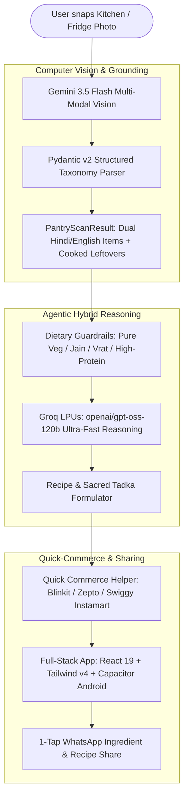

# 🍲 kadhAI (कढ़ाई AI)

> **The Multi-Modal Agentic Chef for Indian Kitchens & Quick-Commerce Arbitrage.**  
> *Transforming noisy Indian fridge photos into authentic regional recipes, zero-waste leftover transformations, and 10-minute grocery unlock links.*

[](https://github.com/Paritosh8-AI/kadhAI/actions/workflows/build-apk.yml)
[](LICENSE)
[](https://fastapi.tiangolo.com)
[](https://react.dev)
[](https://capacitorjs.com)
[](https://groq.com)
[](https://ai.google.dev)

---

## 🌟 Why kadhAI?

Generic AI cooking apps fail miserably in Indian households:
1. **Noisy Fridge Chaos**: Cluttered shelves, steel *katoris*, plastic bags, and vegetable *tokris*.
2. **Missing Culinary Nuance**: Inability to differentiate *jeera* (cumin) from *saunf* (fennel), neglecting wilting *dhaniya*, or missing Indian leftover *Jugaad* (repurposing cold dal into *Dal Paratha* or dry rotis into *Vaghareli Roti*).
3. **The Sacred Tadka**: Disregarding traditional base fats (Mustard Oil vs. Desi Ghee) and strict tempering sequence (*Hing ➔ Jeera ➔ Rai ➔ Curry Leaves*).
4. **Pantry Gaps**: Recipes demanding items you don't have, without direct quick-commerce links to restock them in 10 minutes.

**kadhAI** solves all of this with an end-to-end, multi-modal hybrid agentic pipeline.

---

## 🏗️ Technical Architecture



---

## ⚡ Tech Stack & Highlights

| Tier | Technology | Purpose |
| :--- | :--- | :--- |
| **Vision Inference** | **Google Gemini 3.5 Flash** | Sub-second visual parsing of cluttered, occluded fridge images into strictly typed schemas. |
| **Agentic Reasoning** | **Groq Cloud (`openai/gpt-oss-120b`)** | Sub-2s recipe generation, dietary guardrails, and Sacred Tadka synthesis. |
| **Mobile App** | **Capacitor + React 19 + Tailwind v4** | Native Android application (`com.kadhai.app`) with camera integration & smooth animations. |
| **Authentication** | **SQLite + Phone OTP** | Indian mobile number verification (`+91`) with 4-digit OTP challenge. |
| **Backend API** | **FastAPI + Uvicorn** | High-performance asynchronous API serving both JSON endpoints and web assets. |
| **CI/CD** | **GitHub Actions** | Automated compilation of installable `app-debug.apk` and production `app-release-unsigned.apk`. |
| **Commerce Links** | **Deep Linking** | Real-time query generators for **Blinkit**, **Zepto**, and **Swiggy Instamart**. |

---

## 📲 Download & Installation

### Android APK (Automated via GitHub Actions)
Every commit to `master` builds fresh Android APKs automatically:
1. Navigate to [kadhAI GitHub Actions](https://github.com/Paritosh8-AI/kadhAI/actions).
2. Click on the latest **Build Production Android APK** run.
3. Download the **`kadhAI-installable-apk`** artifact.
4. Install `app-debug.apk` directly on any Android smartphone.

### Local Development Setup

```bash
# 1. Clone repository
git clone https://github.com/Paritosh8-AI/kadhAI.git
cd kadhAI

# 2. Set up Python virtual environment
python -m venv .venv
.\.venv\Scripts\activate   # Windows
# source .venv/bin/activate # Linux/macOS

# 3. Install Python dependencies
pip install -r requirements.txt

# 4. Configure environment keys
copy .env.example .env
# Edit .env with your free GEMINI_API_KEY and GROQ_API_KEY

# 5. Build frontend
cd frontend
npm install
npm run build
cd ..

# 6. Start full-stack server
python -m uvicorn server:app --host 0.0.0.0 --port 8000
```

---

## 📜 License
Apache-2.0 License. Built with ❤️ for Indian home chefs and AI engineers.
