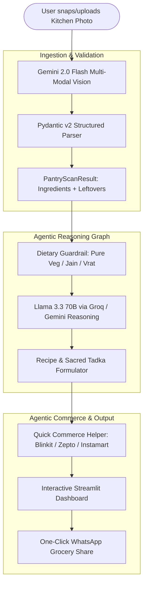

# 🍲 KadhaiAI (कढ़ाई AI)

> **The Multi-Modal Agentic Chef for Indian Kitchens & Quick-Commerce Arbitrage.**  
> *Transforming noisy Indian fridge photos into authentic regional recipes, zero-waste leftover transformations, and 10-minute grocery unlock links.*

---

## 🌟 Why KadhaiAI?

Generic AI cooking tools fail in Indian kitchens. They can't tell the difference between *jeera* and *saunf*, overlook wilting *dhaniya*, and miss the cultural staple of **Jugaad Cooking** (repurposing cold dal into *Dal Paratha* or dry rotis into *Vaghareli Roti*).

**KadhaiAI** solves this with an end-to-end multi-modal agentic architecture designed specifically for Indian culinary conventions:

- 📸 **Computer Vision for Indian Fridges**: Ingests photos of refrigerators, vegetable baskets (*tokris*), and pantry shelves to extract items with dual English & Hindi taxonomy.
- 🍛 **Cooked Leftover Detection**: Identifies stainless steel *dabbas* containing leftover dal, boiled rice, or stale rotis and prioritizes zero-waste repurposing.
- 🕊️ **Dietary Boundary Enforcement**: Deterministic guardrails for **Jain** (strictly no onion, garlic, or root vegetables), **Pure Veg**, **Vrat/Fasting**, and high-protein targets.
- 🔥 **The Sacred Tadka**: Automatically specifies base fats (Mustard Oil vs. Desi Ghee) and exact spice spluttering sequences (*Hing ➔ Jeera ➔ Rai ➔ Curry Leaves*).
- ⚡ **Agentic Quick-Commerce Arbitrage**: Calculates missing ingredient ROI and generates instant search deep-links for **Blinkit**, **Zepto**, and **Swiggy Instamart**.
- 📲 **1-Click WhatsApp Export**: Formats the recipe and missing grocery items for easy sharing with family members or roommates.

---

## 🏗️ Architecture



---

## ⚡ Tech Stack (100% Free Tier)

| Component | Technology | Role |
| :--- | :--- | :--- |
| **Vision Inference** | **Google Gemini 2.0 Flash** | Ultra-fast multi-modal image understanding & visual grounding. |
| **Agentic Reasoning** | **Groq Cloud (Llama 3.3 70B)** | High-speed structured recipe formulation and constraint solving. |
| **Orchestration** | **LangGraph** | Stateful cyclic agent graph managing dietary rules & leftovers. |
| **Data Contracts** | **Pydantic v2** | Strict typing, runtime validation, and zero-hallucination parsing. |
| **Quick Commerce** | **Custom URL Generators** | Deep-links for Blinkit, Zepto, and Swiggy Instamart. |
| **UI** | **Streamlit** | Mobile-responsive web interface with camera snap integration. |

---

## 🚀 Quickstart & Local Setup

### 1. Clone the repository
```bash
git clone https://github.com/your-username/KadhaiAI.git
cd KadhaiAI
```

### 2. Create and activate a virtual environment
```bash
python -m venv .venv
# Windows:
.\.venv\Scripts\activate
# Linux/macOS:
source .venv/bin/activate
```

### 3. Install dependencies
```bash
pip install -r requirements.txt
```

### 4. Configure Environment Variables (Optional)
Copy `.env.example` to `.env` and add your free API keys:
```env
GEMINI_API_KEY=your_gemini_api_key_here
GROQ_API_KEY=your_groq_api_key_here
```
*(Note: KadhaiAI includes a complete offline Demo Mode, allowing full testing even without API keys!)*

### 5. Run the Application
```bash
streamlit run app.py
```

### 6. Run Unit Tests
```bash
pytest tests/
```

---

## 🎯 Key AI Engineering Concepts Demonstrated

1. **Multi-Modal Visual Grounding**: Forcing visual models to parse cluttered, occluded real-world fridge images into strictly validated Pydantic schemas.
2. **Deterministic Agent Guardrails**: Preventing dietary violations (e.g., Jain compliance) using programmatically enforced state filters prior to LLM reasoning.
3. **Domain-Specific Taxonomy**: Encoding traditional Indian culinary rules (gravy bases, spice tempering orders, and leftover repurposing) into agent prompts.
4. **Agentic Commerce Integration**: Transforming identified pantry gaps into actionable quick-commerce deep-links.

---

## 📜 License
Apache-2.0 License. Built for home chefs and AI engineers.
